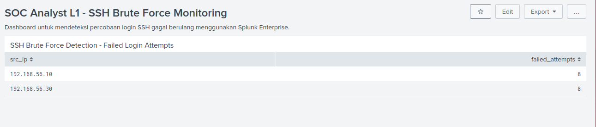
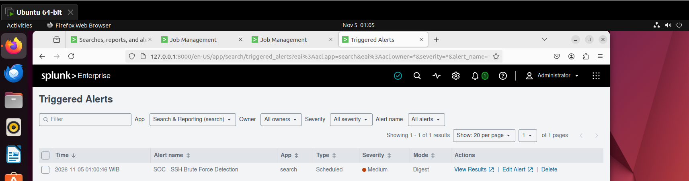
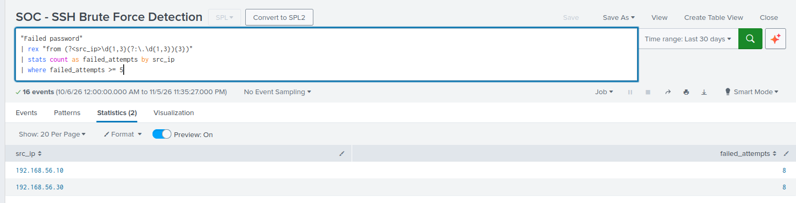

# Splunk SOC Analyst L1 – SSH Brute Force Detection

## Project Overview

This project demonstrates a beginner-level Security Operations Center (SOC) workflow using Splunk Enterprise to detect repeated SSH authentication failures that may indicate a brute-force attack.

The lab uses simulated Linux authentication logs to identify suspicious source IP addresses, count failed login attempts, visualize detection results, and generate scheduled alerts.

## Objectives

- Ingest and analyze Linux authentication logs.
- Detect repeated SSH failed login attempts.
- Identify suspicious source IP addresses.
- Create a monitoring dashboard.
- Configure and validate scheduled alerts.
- Practice basic SOC Analyst L1 investigation workflows.

## Lab Environment

| Component | Configuration |
|---|---|
| SIEM | Splunk Enterprise 10.6.1.1 |
| Operating System | Ubuntu 22.04.5 LTS |
| Virtualization | VMware Workstation 17.6.4 |
| Data Source | Simulated Linux SSH authentication logs |
| Splunk Index | `main` |
| Sourcetype | `linux_secure` |

## Detection Logic

The detection identifies source IP addresses with five or more failed SSH login attempts.

### SPL Query

```spl
"Failed password"
| rex "from (?<src_ip>\d{1,3}(?:\.\d{1,3}){3})"
| stats count as failed_attempts by src_ip
| where failed_attempts >= 5
```

### Detection Threshold

- Event pattern: `Failed password`
- Aggregation: Failed attempts grouped by source IP.
- Threshold: 5 or more failed attempts.

## Detection Results

The lab identified the following simulated SSH authentication activity:

| Source IP | Failed Attempts |
|---|---:|
| 192.168.56.10 | 8 |
| 192.168.56.30 | 8 |
| **Total** | **16** |

Both source IP addresses exceeded the configured detection threshold.

## Monitoring Dashboard

Dashboard name: `SOC Analyst L1 - SSH Brute Force Monitoring`

Dashboard panel:
`SSH Brute Force Detection - Failed Login Attempts`

The dashboard displays suspicious source IP addresses and their corresponding failed login counts.

## Alert Configuration

Alert name: `SOC - SSH Brute Force Detection`

| Setting | Configuration |
|---|---|
| Alert Type | Scheduled |
| Schedule | Hourly |
| Time Range | Last 30 days |
| Trigger Condition | Number of Results greater than 0 |
| Trigger | Once |
| Action | Add to Triggered Alerts |
| Severity | Medium |

**Validation:** A scheduled alert was successfully recorded in Splunk Triggered Alerts on November 5, 2026, at 01:00:46 WIB.

## Screenshots

### 1. Monitoring Dashboard




### 2. Triggered Alert



### 3. SPL Query Results



## Skills Demonstrated

- Splunk Enterprise fundamentals
- SIEM log analysis
- SPL (Search Processing Language)
- SSH brute-force detection
- Linux authentication log analysis
- Dashboard development
- Scheduled alert configuration
- Basic security event investigation

## Disclaimer

This project was developed in a controlled virtual lab environment using simulated authentication logs.

The IP addresses and failed login attempts are test data and do not represent real-world attacks or unauthorized access.

## Future Improvements

- Integrate live Linux authentication logs.
- Add SSH successful-login correlation.
- Develop additional detection rules.
- Improve alert notification workflows.
- Expand the SOC monitoring dashboard.
